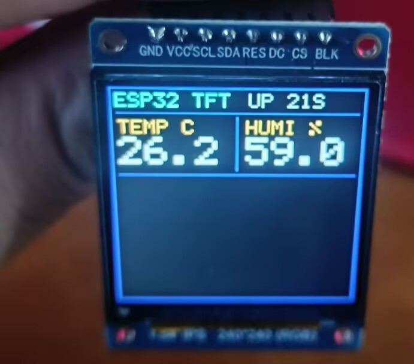

给 ESP32-S3 配了一块 1.54 寸 240×240 IPS 屏（ST7789，SPI 接口），用来显示 SHT3x 温湿度。

调这块屏比预想的曲折得多：先是花屏，改了几个参数变成全黑，之后又冒出来上半屏不动、文字撕裂……
前前后后其实踩了 4 个互不相干的坑，只是它们叠在一起，看起来像"越修越坏"。



---

## 硬件

| 部件 | 规格 |
|---|---|
| 主控 | ESP32-S3-N16R8（16 MB Flash / 8 MB Octal PSRAM） |
| 屏幕 | 1.54" IPS 240×240，ST7789，8 pin SPI |
| 传感器 | SHT3x（SHT30 / SHT31 / SHT35，I2C，默认地址 `0x44`） |
| 框架 | ESP-IDF **v5.5.5**，纯 C |

## 接线

### 屏幕（SPI）

| 屏幕引脚 | ESP32-S3 | 说明 |
|---|---|---|
| GND | GND | 共地，越短越好 |
| VCC | 3.3V | |
| SCL | **GPIO12** | SPI 时钟 |
| SDA | **GPIO11** | MOSI |
| RES | **GPIO14** | 复位 |
| DC | **GPIO13** | 命令 / 数据选择 |
| CS | **GPIO10** | 片选 |
| BLK | 3.3V | 背光常亮 |

### 传感器（I2C）

| SHT3x | ESP32-S3 |
|---|---|
| VCC | 3.3V（**不要接 5V**） |
| GND | GND |
| SDA | **GPIO8** |
| SCL | **GPIO9** |
| ADDR | 悬空 / 接 GND → `0x44`；接 VCC → `0x45` |

> 大多数 SHT3x **模块**板上已焊 10k 上拉电阻，直接插即可。
> 裸芯片转接板需要自己加 4.7k–10k 上拉到 3.3V（内部上拉只有 ~45k，长线不稳）。

---

## 这块屏的参数（最重要的一节）

| 参数 | 值 | 为什么 |
|---|---|---|
| `esp_lcd_panel_set_gap()` | **(0, 0)** | ST7789 显存是 240×320，这块屏只用第 **0–239** 行 |
| `esp_lcd_panel_invert_color()` | **true** | IPS 屏不开反色，颜色会像底片 |
| `rgb_ele_order` | **RGB** | 不用 BGR |
| `data_endian` | **LITTLE** | 用默认的 BIG，红色会显示成蓝色 |
| `pclk_hz` | 8 MHz | 稳定值，可继续上探 |
| `spi_mode` | 0 | |

```c
esp_lcd_panel_dev_config_t panel_config = {
    .reset_gpio_num = PIN_RST,
    .rgb_ele_order  = LCD_RGB_ELEMENT_ORDER_RGB,
    .data_endian    = LCD_RGB_DATA_ENDIAN_LITTLE,   // ← 关键
    .bits_per_pixel = 16,
};
esp_lcd_new_panel_st7789(io, &panel_config, &panel);
...
esp_lcd_panel_set_gap(panel, 0, 0);                  // ← 关键
esp_lcd_panel_invert_color(panel, true);             // ← 关键
```

> ⚠️ **不要**照抄网上的 `esp_lcd_panel_io_tx_param(io, 0xB0, (uint8_t[]){0x00, 0x18}, 2)`。
> IDF 的 `init()` 已经发过 `0xB0 RAMCTRL = {0x00, 0xF0}`，再发一条是用错误参数覆盖正确参数。
> 正确的做法是改 `data_endian`，它会生成 `{0x00, 0xF8}`。

---

## 快速开始

```bash
# 需要 ESP-IDF v5.5.x
idf.py set-target esp32s3
idf.py build
idf.py -p COM3 flash monitor
```

串口 115200，正常会看到：

```
I (xxx) TEMP_HUMI: 找到 SHT3x，地址 0x44
I (xxx) TEMP_HUMI: T=26.31 C  H=58.72 %
```

---

## 功能

| 功能 | 说明 |
|---|---|
| 5×7 点阵字库 | 43 个字符（数字 / 大写字母 / 常用符号），可任意倍率放大，**无第三方依赖** |
| SHT3x 驱动 | 自己实现：单次测量 + CRC8 校验 + `0x44`/`0x45` 自动扫描 |
| 滑动平均 | 4 点平均，读数不会乱跳 |
| 容错显示 | 传感器未接 / 读失败时显示 `--.-`，底部红字 `NO SENSOR` |
| DMA 同步 | 每次刷屏等传输真正完成再复用缓冲区，不会撕裂 |

## 界面

```
┌──────────────────────────────┐
│ ESP32 TFT          UP 42S    │  标题行
├──────────────────────────────┤
│ TEMP C      │    HUMI %      │  标签
│  26.2       │    59.0        │  数值（4 倍字号）
├──────────────────────────────┤
│                              │
│        预留区域（148 行）      │
│                              │
│ SHT3X READY                  │  状态行
└──────────────────────────────┘
```

---

## 踩过的 4 个坑（速查）

| # | 现象 | 根因 | 修复 |
|---|---|---|---|
| 1 | 加了 `0xB0` 之后彻底黑屏，背光亮 | 手写的 RAMCTRL 覆盖了 IDF 的正确值 | 删掉，改用 `data_endian` |
| 2 | 最上面约 80 行永远不变，下面才刷新 | `set_gap(0, 80)` 设错，画面写到 GRAM 80–319 | 改成 `(0, 0)` |
| 3 | 红色显示成蓝色，黑白正常 | 字节序：`0xF800` 内存里是 `00 F8`，被当大端解析 | `LCD_RGB_DATA_ENDIAN_LITTLE` |
| 4 | 文字虚化、撕成横条、斜向拖影 | `draw_bitmap` 是异步的，DMA 还在读时缓冲区被改写 | `on_color_trans_done` + 信号量等待 |

**为什么这 4 个错误会同时出现？** 因为前 3 个都跟"屏能不能正常显示"有关，
现象互相掩盖；第 4 个只有画面正常后才会暴露出来。

详细推导、波形、标定方法见 **[docs/DEBUG_LOG.md](docs/DEBUG_LOG.md)**。

---

## 代码结构

```
st7789_test/
├── main/
│   ├── hello_world_main.c     ← 全部逻辑都在这里
│   └── CMakeLists.txt
├── docs/
│   ├── DEBUG_LOG.md           ← 详细调试记录
│   └── images/                ← 实拍照片
├── CMakeLists.txt
└── README.md
```

`hello_world_main.c` 按功能分成 9 段，改代码时对照最上面的注释编号找：

| 段 | 内容 |
|---|---|
| 1 | 接线（引脚宏） |
| 2 | 屏幕参数 |
| 3 | 数据源开关 |
| 4 | 5×7 点阵字库 + 查表 |
| 5 | DMA 同步 + 绘图（`lcd_blit` / `lcd_fill` / `draw_text`） |
| 6 | SHT3x 驱动 |
| 7 | 数据源 + 滑动平均 |
| 8 | 屏幕初始化 |
| 9 | 界面 |

---

## 依赖

只用 ESP-IDF 自带组件，无需 component manager：

```
esp_lcd  driver  freertos  esp_system  esp_timer  esp_driver_i2c
```

---

## 后续计划

- [ ] 温度曲线（用掉下半页 148 行）
- [ ] 最大 / 最小值记录
- [ ] 中文标签（16×16 点阵，只生成用到的字）
- [ ] `sdkconfig` 的 Flash 大小改成 16 MB（当前还是 2 MB）
