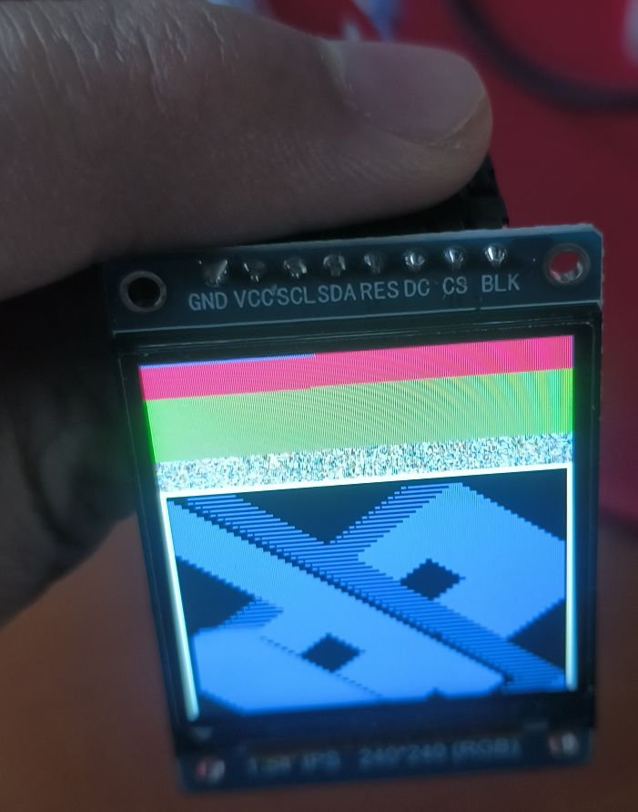
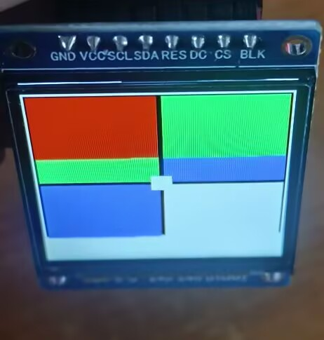
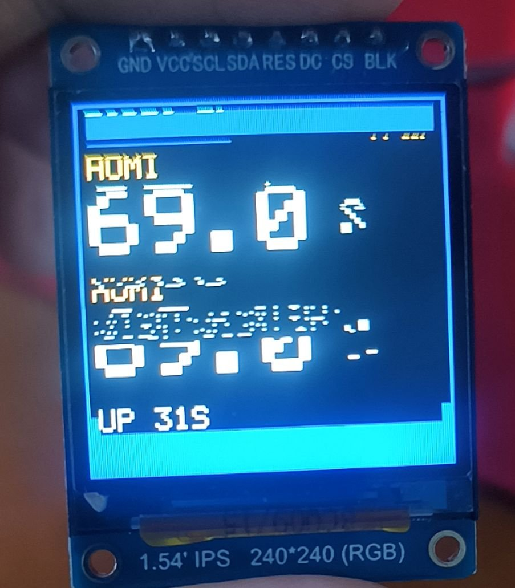

# 调试记录：ST7789 1.54" 240×240 从花屏到点亮

> 主控 ESP32-S3-N16R8，框架 ESP-IDF v5.5.5，屏幕 1.54 寸 IPS 240×240（ST7789，SPI）。
> 这份记录按"现象 → 假设 → 验证 → 结论"的顺序写，方便对照自己的情况。

---

## 0. 现象演变

| 阶段 | 做了什么 | 看到什么 |
|---|---|---|
| 1 | 官方驱动，10 MHz，240×240，RGB | 能出画面，但严重花屏：横向绿色/蓝色色带 + 大量雪花噪点 + 中间一块能看清的白色方块 |
| 2 | 降频到 5 / 2 MHz，改 BGR，开 `invert_color(true)`，加 `set_gap(0, 80)` | 依旧雪花 + 错位色带 |
| 3 | 加 `0xB0 {0x00, 0x18}`，换第二组引脚 | **彻底黑屏**，背光亮 |
| 4 | 退回第一组引脚，删掉所有额外命令，降到 1 MHz | 依旧全黑，**串口零报错** |

这段最容易误判的地方是：**看起来像"一个 bug 越修越坏"，实际是 4 个互不相干的 bug 叠在一起**，
而且它们互相掩盖 —— 前 3 个让你看不到画面，第 4 个只有画面正常后才暴露。

---

## 1. 黑屏 —— `0xB0` 覆盖了 RAMCTRL

### 现象

加了一条命令之后就全黑了，而且删掉代码重新烧录**仍然是黑的**。

```c
// 网上流传的"修正显存字节序"偏方
esp_lcd_panel_io_tx_param(io, 0xB0, (uint8_t[]){0x00, 0x18}, 2);
```

### 为什么

`0xB0` 不是"字节序修正命令"，它就是 **RAMCTRL（显存控制寄存器）**，
而 ESP-IDF 的 `esp_lcd_new_panel_st7789()` 在 `init()` 里**已经发过一条了**：

```c
// esp-idf/components/esp_lcd/src/esp_lcd_panel_st7789.c:182
static esp_err_t panel_st7789_init(esp_lcd_panel_t *panel)
{
    esp_lcd_panel_io_tx_param(io, LCD_CMD_SLPOUT, NULL, 0);      // 0x11
    vTaskDelay(pdMS_TO_TICKS(100));
    esp_lcd_panel_io_tx_param(io, LCD_CMD_MADCTL, &madctl, 1);   // 0x36
    esp_lcd_panel_io_tx_param(io, LCD_CMD_COLMOD, &colmod, 1);   // 0x3A = 0x55
    esp_lcd_panel_io_tx_param(io, ST7789_CMD_RAMCTRL,            // 0xB0
                              (uint8_t[]){0x00, 0xF0}, 2);
}
```

也就是说：**IDF 已经写好了正确的值，我们又用一个错误的值覆盖了它。**

### `0x18` 到底错在哪

| 值 | 二进制 | 来源 | 说明 |
|---|---|---|---|
| `0xF0` | `1111 0000` | IDF 默认 | 大端（MSB first） |
| `0xF8` | `1111 1000` | `LCD_RGB_DATA_ENDIAN_LITTLE` | 小端（LSB first），正确写法 |
| `0x18` | `0001 1000` | 网上偏方 | 额外把 bit7 / bit6 / bit5 **清零**了 |

注意 `0x18` **不等于** `0xF8` —— 它在设置 bit3 的同时，把 bit7/6/5 也清掉了，
这几位不属于 endian 位。不同批次的 ST7789（V / V2 / VW）对这几位的行为并不一致。

### 为什么删掉代码还是黑

RAMCTRL 是**控制器内部寄存器**，写进去之后只有两种方式清除：

1. 硬件复位（`RES` 引脚低脉冲）
2. 断电

如果 `RST` 那根线虚接 / 插错排针 / 杜邦线松了，ESP32 的复位对屏幕就是**无效**的，
于是复位引脚形同虚设，只能靠**拔电**恢复。

> **验证方法**：断电 10 秒再上电。
> 如果画面回到"花屏"，就证明是寄存器锁存，同时说明 `RST` 线没起作用 —— 这本身就是必须修的问题。

### 修复

```c
// 不要手写 RAMCTRL，用官方 API
esp_lcd_panel_dev_config_t cfg = {
    .data_endian = LCD_RGB_DATA_ENDIAN_LITTLE,   // 生成 {0x00, 0xF8}
};
```

---

## 2. 上半屏固定不动 —— gap 设错

### 现象



屏幕最上面约 1/3 是**永远不变**的粉红 / 绿色 / 雪花三条带，
下面 2/3 的画面是正常的、会刷新的。

### 算一下就明白了

数照片里的行数（按屏高 240 行折算）：

| 区域 | 像素高 | 折算行数 |
|---|---|---|
| 粉红条 | 45 | ≈ 24 |
| 绿色条 | 70 | ≈ 37 |
| 雪花条 | 35 | ≈ 18 |
| **不动的小计** | 150 | **≈ 80** |
| 会动的区域 | 305 | ≈ 160 |
| 合计 | 455 | 240 |

**80 + 160 = 240。**

### 原理

ST7789 的显存（GRAM）是 **240×320**，而这块屏只有 240×240，所以只能显示其中 240 行。
**显示哪 240 行，不同模组不一样**：

| 模组类型 | 显示 GRAM 的哪一段 | 对应 `set_gap()` |
|---|---|---|
| 常见 1.54" 240×240 | 第 **80–319** 行 | `(0, 80)` |
| **本项目这块** | 第 **0–239** 行 | **`(0, 0)`** |

代码里设了 `gap = 80`，于是：

```
我们写的 GRAM:   [80 ......................... 319]   ← 我们的 y = 0..239
屏实际显示的:    [0 .......................... 239]
                  ↑↑↑
                  GRAM 0~79 从来没人写过
                  = 上电时的随机显存 = 那三条色带
```

同时我们的第 160–239 行被写进 GRAM 240–319，**超出可见区被裁掉** ——
所以画面不但偏下，还"少了三分之一"，看起来像被压扁了。

### 判断方法

不用猜，**看有没有一条"永远不变"的条带**：

- 顶部有不变条带 → `gap` 设大了（写到了下面去）
- 底部有不变条带 → `gap` 设小了
- 四边都有白边框完整显示 → `gap` 正确

最简单的验证：画一个 **2px 贴边的白框**。四条边都在，说明 240×240 全部用上了。

### 修复

```c
esp_lcd_panel_set_gap(panel, 0, 0);
```

---

## 3. 红显示成蓝 —— 字节序

### 现象



红色 `0xF800` 显示成蓝色，但**黑色和白色完全正常**。

### 原理

`0xF800` 是一个 `uint16_t`，在 x86 / Xtensa 这类小端机器内存里存成两个字节：

```
内存:  [0x00] [0xF8]
       低字节  高字节
```

SPI 按内存顺序逐字节发出，屏幕上先收到 `0x00`，再收到 `0xF8`。
如果控制器按**大端**解释（先收到的当高字节），拼出来就是：

```
0x00 << 8 | 0xF8  =  0x00F8
                     RRRRR GGGGGG BBBBB
                     00000 001111 11000   →  R=0, G=15, B=24  → 暗蓝色
```

红色变蓝色，完全对上。

### 字节序错误的"指纹"

| 发送值 | 大端解析结果 | 你会看到 |
|---|---|---|
| `0xF800` 红 | `0x00F8` | **蓝** |
| `0x07E0` 绿 | `0xE007` | **红/橙** |
| `0x001F` 蓝 | `0x1F00` | **绿** |
| `0xFFFF` 白 | `0xFFFF` | 白 ✓ |
| `0x0000` 黑 | `0x0000` | 黑 ✓ |

**关键指纹：黑白正常，但红↔蓝、绿↔红、蓝↔绿 循环错位。**
看到这个组合，不用怀疑别的，就是字节序。

### 修复

```c
.data_endian = LCD_RGB_DATA_ENDIAN_LITTLE,   // 0x00, 0xF8
```

> 另一种情况：颜色"很怪但位置对"、红偏紫、白偏黄 —— 那是 **RGB / BGR 元素顺序**错了，
> 改 `rgb_ele_order`，跟字节序不是一回事。

---

## 4. 字虚化 / 斜向撕裂 —— DMA 缓冲区竞态

### 现象



画面颜色和位置都对，但字是"虚"的：横条纹、字被撕成虚线、大片斜向拖影。

### 原理

`esp_lcd_panel_draw_bitmap()` 是**异步**的 —— 它把缓冲区指针交给 SPI 驱动、
放进 `trans_queue_depth` 队列就返回了，DMA 在后台慢慢发。

如果紧接着又往**同一个缓冲区**写下一帧：

```
t0: draw_bitmap(温度)  → 排队，返回
t1:   ... DMA 正在读 s_buf ...
t2: draw_bitmap(湿度)  → 马上往 s_buf 写新内容
        ↑ DMA 读到一半，前半是新数据、后半是旧数据
t3: DMA 把这份"混合内容"发到屏幕
```

在 8 MHz 下发一个 160×48 的文本块要 ~15 ms，
而 CPU 重新填满这块缓冲区只要不到 1 ms —— 竞态几乎必然发生。

### 修复：等传输真正结束再复用缓冲区

```c
static SemaphoreHandle_t s_flush_done;

static bool on_color_trans_done(esp_lcd_panel_io_handle_t io,
                                esp_lcd_panel_io_event_data_t *edata, void *ctx)
{
    BaseType_t need_yield = pdFALSE;
    xSemaphoreGiveFromISR(s_flush_done, &need_yield);
    return need_yield == pdTRUE;
}

// 注册回调
esp_lcd_panel_io_spi_config_t io_config = {
    ...
    .on_color_trans_done = on_color_trans_done,
};

// 每次刷屏都等
static esp_err_t lcd_blit(int x0, int y0, int x1, int y1)
{
    esp_lcd_panel_draw_bitmap(s_panel, x0, y0, x1, y1, s_buf);
    xSemaphoreTake(s_flush_done, pdMS_TO_TICKS(2000));   // ← 关键
    return ESP_OK;
}
```

### 副作用

变慢了：整屏重画从"不等"变成约 115 ms（8 MHz）。
但这是**正确性代价** —— 不等就是错的，快也没用。

想要又快又对，可以上**双缓冲**（两块缓冲区轮流用），但这块屏 240×240 的需求用不上。

---

## 5. 附：逻辑分析仪该看什么

如果手上有逻辑分析仪，接 `SCL / SDA(MOSI) / CS / DC / RES` 五根，
触发用 `RES` 下降沿（按一下开发板 RST 键即可），采样率 ≥ 20 MS/s。

期望抓到（顺序、字节、DC 电平都必须一致）：

```
上电 → RES 低 10ms → 高
                    ↓ 静默 120ms（代码里的 vTaskDelay）
[CS↓ DC=0] 0x11                            SLPOUT
                    ↓ 静默 100ms  ← 最好的定位锚点
[CS↓ DC=0] 0x36 ; [DC=1] 0x00              MADCTL
[CS↓ DC=0] 0x3A ; [DC=1] 0x55              COLMOD = 16bpp
[CS↓ DC=0] 0xB0 ; [DC=1] 0x00 0xF0         RAMCTRL
[CS↓ DC=0] 0x20                            INVOFF / 0x21 INVON
[CS↓ DC=0] 0x29                            DISPON
[CS↓ DC=0] 0x2A ; [DC=1] 00 00 00 EF       CASET 0..239
[CS↓ DC=0] 0x2B ; [DC=1] 00 00 00 EF       RASET 0..239（gap=0 时）
```

判读表：

| 波形现象 | 结论 |
|---|---|
| `RES` 没有 10 ms 低脉冲 | RST 线虚接 / 接错脚 |
| `0x11` 之后什么都没有 | 程序卡住，或 `init()` 报错 |
| 字节全对但 `DC` 一直不变 | DC 线没通 —— 典型"能通信但完全不出图" |
| 字节全对但 `CS` 极性反 | `cs_high_active` 或 CS 脚接错 |
| 字节全对、数据流完整、屏仍不亮 | MCU 侧没问题，查供电 / 屏本体 |

> **重要认知**：SPI 是单向写，没有 MISO、没有 ACK。
> `draw_bitmap()` 返回 `ESP_OK` 只代表**外设把字节搬完了**，
> **不代表屏幕收到了、更不代表解对了**。所以"串口没报错"不能作为屏幕正常的证据。

---

## 6. 附：四宫格标定法

改任何显示参数后，先画这个图案，一张照片就能判断全部参数对不对：

```
┌─────────────────┐
│  红      │  绿   │
│──────────┼───────│
│  蓝      │  白   │
└─────────────────┘
   2px 白边框 + 中心白点
```

| 看到 | 结论 | 改哪个 |
|---|---|---|
| 四色位置和颜色都对，边框完整 | ✅ 全部正确 | — |
| 红↔青、绿↔洋红、白↔黑 | 反色反了 | `invert_color(false)` |
| 红↔蓝、绿↔红、蓝↔绿 | 字节序反了 | `LCD_RGB_DATA_ENDIAN_*` |
| 边框被切、有一侧不变色带 | 窗口偏移 | `set_gap()` |
| 四块都在但整体镜像 | MADCTL | `esp_lcd_panel_mirror()` |

---

## 7. 复盘：几条经验

1. **先用"能不能画出稳定画面"分层，不要一上来就调颜色。**
   能画出纯色 → 数据通路 OK；画不出 → 别碰 gap / gamma / 反色，那是浪费时间。

2. **`esp_lcd` 的默认初始化通常是对的，不要往里塞偏方命令。**
   IDF v5.5 的 ST7789 驱动只发 4 条命令，够用。
   而且它**不支持** `vendor_config->init_cmds`（头文件里没有这个结构体），网上让你传自定义 init 表的写法是无效的。

3. **现象有"统计特征"时，去数。**
   "上面 80 行不动" → 数出来正好 80 行 → 直接定位到 gap，比盲试十次参数快得多。

4. **异步 API 要检查缓冲区生命周期。**
   凡是 `draw_bitmap` / `tx_color` 之类带 queue 的接口，都要问一句"我的缓冲区什么时候才能安全复用"。

5. **串口无报错 ≠ 硬件正常。** 单向接口没有握手，只能靠逻辑分析仪或"画个可验证的图案"。

6. **同一时间只改一个变量。** 这次 4 个错误同时存在，每次改 3 个参数，改完既不知道哪个生效也不知道哪个引入新问题。

---

## 附：调试时间线

| 步骤 | 动作 | 得到的信息 |
|---|---|---|
| 1 | 复现并记录现象 | 确认 4 个阶段的现象差异 |
| 2 | 读 IDF 源码 | 发现 `init()` 已发 `0xB0` |
| 3 | 重写为最小可运行固件 | 缩小变量，确认是参数不是硬件 |
| 4 | 纯色 / 四宫格测试 | 定位 gap |
| 5 | 照片数行数 | gap = 0 定量确认 |
| 6 | 颜色指纹比对 | 确认字节序 |
| 7 | 观察"字虚化" | 定位 DMA 竞态 |
| 8 | 加信号量同步 | 画面干净 |
